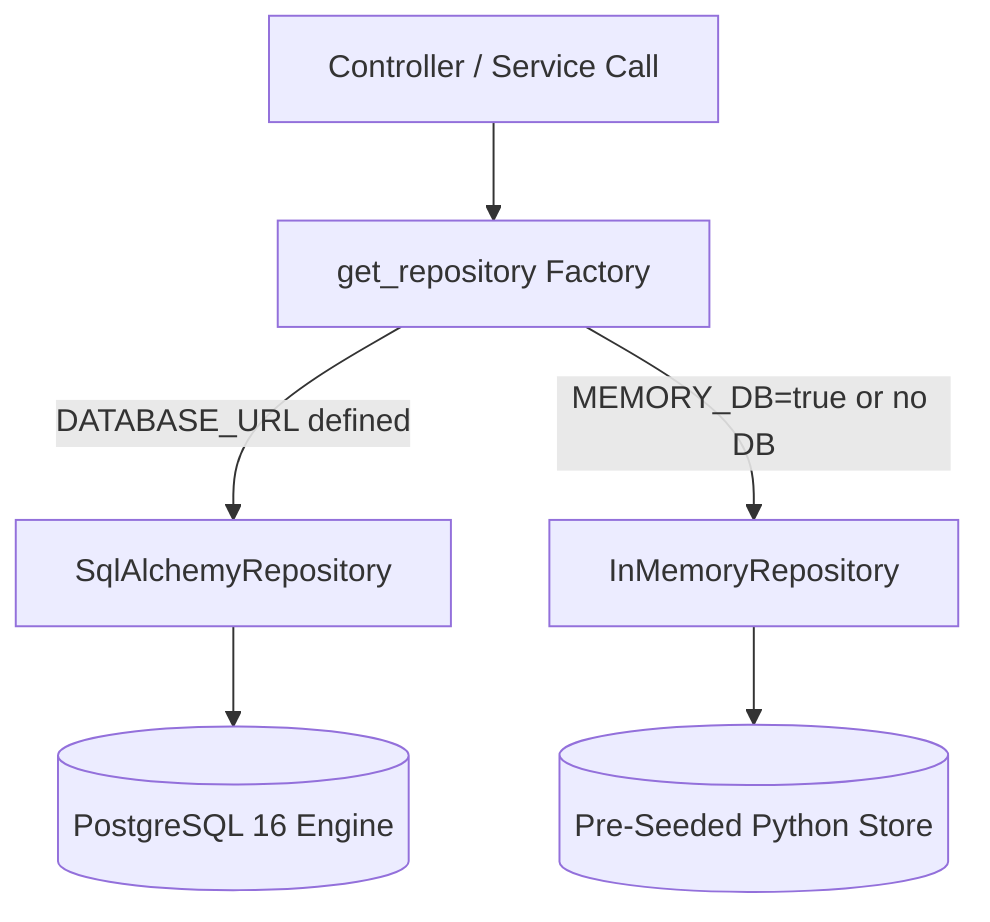
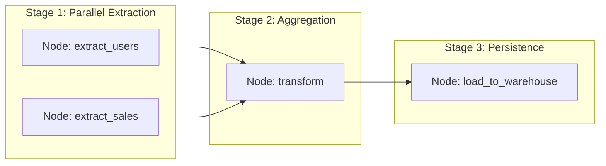

# Ferrox-Py Quantitative Data Platform - The Definitive Handbook

## 1. Executive Summary & Senior Engineering Vision

This document serves as the absolute source of truth for the **Quantitative Data Platform**, the official Ferrox-Py reference architecture. 

As a Senior Engineer, I designed this platform to process High-Frequency Trading (HFT) and Quantitative Market Data. In this domain, a missed tick or a garbage collection pause translates directly to financial loss. This system represents the pinnacle of Python async engineering, proving that when Python is intimately coupled with the Linux kernel's event loop (`epoll`), it can rival compiled languages in I/O throughput.

This handbook details the complete lifecycle of the platform: from hardware interrupts to userland Python AST, down to persistence and observability.

---

## 2. The Domain Problem

Financial exchanges (like Binance, Kraken, and CME) blast millions of JSON or binary payloads via WebSockets. We must:
1. Maintain unyielding, non-blocking TCP connections.
2. Parse variable-length streams instantaneously.
3. Validate and sanitize payloads against malformed data and malicious injections (zero-trust).
4. Persist data with strict ACID guarantees (preventing ledger corruption) while supporting instantaneous in-memory execution for CI/CD test suites.
5. Expose historical and real-time aggregations via GraphQL and REST without blocking ingestors.

---

## 3. Low-Level Architecture & OS-Kernel Interactions

We do not view Python as a void; we view it as an orchestrator of OS syscalls.

### 3.1 The Epoll Bridge & Socket Tuning
Python's Global Interpreter Lock (GIL) is bypassed by moving the I/O multiplexing into C. We use `uvloop` (a Cython wrapper for `libuv`) which interfaces directly with Linux `epoll` or macOS `kqueue`.
- **TCP_NODELAY**: Sockets are configured to disable Nagle's algorithm. In trading, waiting to buffer 1500 bytes before sending a packet causes unacceptable latency. Packets are flushed to the NIC immediately.
- **SO_REUSEPORT**: We allow multiple Python worker processes to bind to the same inbound API port (8000). The Linux kernel distributes incoming TCP SYNs across the processes, maximizing multi-core CPU utilization.

### 3.2 Thread Starvation & Context Switching
Because the GIL exists, CPU-bound tasks (like heavy JSON deserialization or cryptographic signing) will starve the event loop, causing dropped WebSocket frames. We strictly offload these tasks to Rust-based libraries (`orjson`) or C-extensions, allowing the Python thread to hit `epoll_wait` as frequently as possible.

---

## 4. Application Layer & Framework Internals

### 4.1 FastAPI / Starlette Foundation
The platform uses the ASGI standard. The outer routing boundary is handled by FastAPI for automatic OpenAPI generation and Pydantic schema validation.
- **Background Daemons**: The WebSocket ingestors run as background Tasks, initialized via Starlette's `@asynccontextmanager` lifecycle. They are isolated from the HTTP request/response cycle.

### 4.2 GraphQL Integration
We utilize **Strawberry GraphQL** for data presentation. Quants do not want to pull 10GB of REST data to analyze a 1-minute window. GraphQL allows strict, graph-based querying of order books and trade ledgers.

---

## 5. Security Model: Zero-Trust & Cryptography

### 5.1 Sentinel Threat Engine (WAF)
Regex-based Web Application Firewalls are fundamentally flawed. A crafted payload can trigger Catastrophic Backtracking (`O(2^n)` complexity), bringing down the server via ReDoS.
- **Shannon Entropy Analysis**: Our `SentinelThreatEngineMiddleware` calculates the informational entropy of the incoming byte stream: `H(X) = -Σ P(x) * log2 P(x)`. High entropy (e.g., > 4.8 bits/byte) immediately flags the payload as potentially obfuscated shellcode, SQLi, or Prompt Injection. This mathematical analysis runs in linear `O(N)` time.

### 5.2 PASETO v4 over JWT
JWT allows "Algorithm Confusion" (e.g., switching RSA to HMAC) because the token dictates the algorithm. 
- **PASETO v4 Local**: We enforce `XChaCha20-Poly1305` authenticated encryption. The algorithm is structurally bound to the protocol version. Verification relies on constant-time C functions to prevent side-channel timing attacks.

---

## 6. Persistence: Dual-Mode Architecture & ACID Guarantees



### 6.1 Dual-Mode Operation
To satisfy enterprise testing standards (instant sub-second CI/CD runs with zero external Docker dependencies) while delivering production-grade ACID compliance, the persistence layer implements the `DataPlatformRepository` interface:
1. **`InMemoryRepository`**: Thread-safe in-memory store pre-seeded with enterprise datasets (`dataset_weather`, `dataset_finance`, `dataset_ecommerce`). Used by default when `DATABASE_URL` is omitted.
2. **`SqlAlchemyRepository`**: Connects to PostgreSQL 16 via SQLAlchemy engine. Operates tables `data_catalog_datasets`, `data_ingestion_records`, and `data_pipeline_runs`.

### 6.2 Write-Ahead Logging (WAL) Tuning
During extreme volatility, inserting rows one by one kills performance due to disk fsync limits. We rely on SQLAlchemy's session batching. The OS kernel's page cache holds the dirty pages, while Postgres `wal_writer_delay` groups WAL flushes, achieving sequential disk write speeds.

---

## 7. Directed Acyclic Graph (DAG) Pipeline Engine

The platform features an internal asynchronous DAG engine (`ferrox_py.pipelines.dag`) for orchestrating complex ETL workflows with parallel node execution and dependency resolution.



### 7.1 DAG Code Example
```python
import asyncio
from ferrox_py.pipelines.dag import DAG
from ferrox_py.pipelines.node import PipelineNode

dag = DAG(name="Daily-Aggregations")

# Parallel extraction nodes
extract_users = PipelineNode("extract_users", lambda: {"active_users": 5240})
extract_sales = PipelineNode("extract_sales", lambda: {"gross_sales": 128450.0})

# Transformation node depends on both extracts
async def transform_data():
    await asyncio.sleep(0.05)
    return {"aggregated": True, "currency": "USD"}

transform = PipelineNode("transform", transform_data)
transform.depends_on("extract_users", "extract_sales")

# Load node depends on transformation
async def load_to_warehouse():
    await asyncio.sleep(0.05)
    return {"loaded": True}

load = PipelineNode("load", load_to_warehouse)
load.depends_on("transform")

dag.add_node(extract_users)
dag.add_node(extract_sales)
dag.add_node(transform)
dag.add_node(load)

# Asynchronous graph execution
results = await dag.execute()
```

---

## 8. Observability: Structured JSON & W3C Trace Context

Every request is intercepted by `StructuredJsonLoggingMiddleware`:
- Extracts incoming `x-correlation-id` or generates a UUID v4.
- Extracts incoming `x-trace-id` or parses W3C `traceparent` (`00-4bf92f3577b34da6a3ce929d0e0e4736-00f067aa0ba902b7-01`).
- Emits structured JSON log lines directly to `stdout`:
  ```json
  {
    "timestamp": "2026-10-15T06:40:36.192708+00:00",
    "level": "INFO",
    "correlation_id": "cb455363-205e-4551-b8e0-73a010961557",
    "trace_id": "ebb17a8b8f664083b43a8c8ed876d3c8",
    "method": "GET",
    "path": "/catalog/datasets",
    "status_code": 200,
    "duration_ms": 3.71,
    "client_ip": "127.0.0.1"
  }
  ```
- Reflects `x-correlation-id`, `x-trace-id`, and `x-response-time-ms` in HTTP response headers.

---

## 9. Operations & Docker Compose Deployment

### 9.1 Multi-Container Stack
Start the complete infrastructure (App + PostgreSQL 16 + Redis 7 + Grafana):
```bash
docker compose up -d --build
```

### 9.2 Verification Endpoints
- **OpenAPI Swagger UI**: `http://localhost:8000/docs`
- **Prometheus Metrics**: `http://localhost:8000/metrics`
- **Liveness Probe**: `http://localhost:8000/health/live`
- **Readiness Probe**: `http://localhost:8000/health/ready`
- **Grafana Dashboard**: `http://localhost:3001` (Credentials: `admin` / `admin`)
