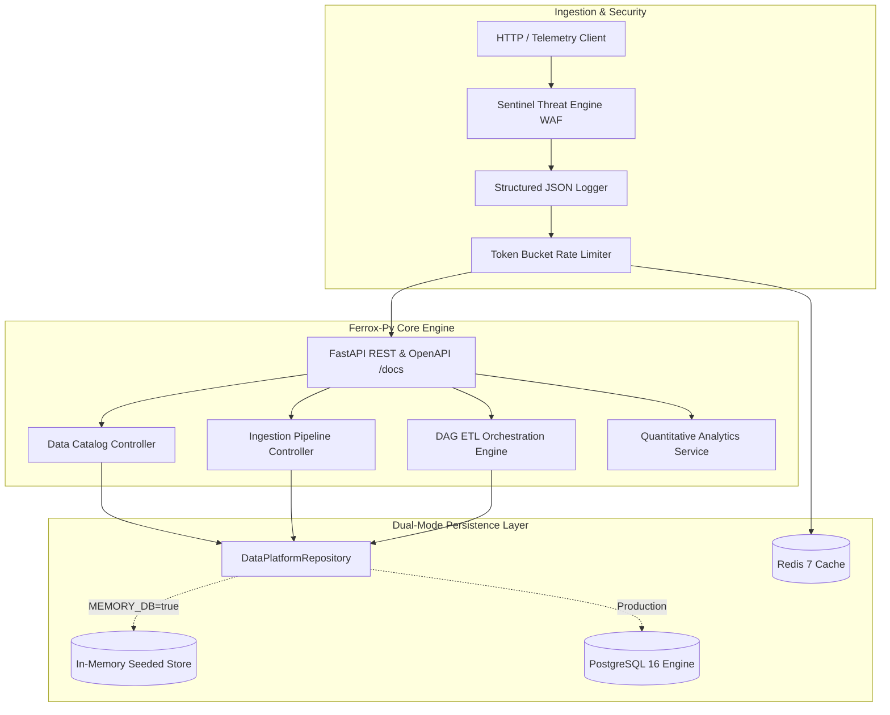

# Ferrox Enterprise Data Platform Showcase

Production-grade asynchronous data engineering platform built on the **Ferrox-Py** framework.



---

## Features

- **Dual-Mode Persistence**: Automatically toggles between high-speed in-memory store (for instant local unit and E2E testing) and PostgreSQL 16 via SQLAlchemy.
- **DAG Pipeline Orchestration**: Directed Acyclic Graph engine (`ferrox_py.pipelines.dag`) supporting parallel node execution, dependency resolution, and timing audit logs.
- **Sentinel Threat Protection**: Mathematical Shannon entropy analysis and regex pattern matching blocking SQL injection, XSS, and path traversal in `O(N)` time.
- **Structured JSON Observability**: Auto-injected `X-Correlation-ID` and `X-Trace-ID` (W3C `traceparent` compliant) with JSON logs ready for Loki, ELK, or Datadog.
- **Native OpenAPI / Swagger**: Complete interactive documentation served at `/docs` and `/redoc` with Pydantic v2 schemas.

---

## Quickstart

### 1. Run Locally (In-Memory Mode)
Zero external dependencies required:

```bash
cd examples/data_platform
pip install -r ../../requirements.txt # or install fastapi uvicorn sqlalchemy pydantic httpx
python main.py
```
Access the interactive documentation: [http://localhost:8000/docs](http://localhost:8000/docs).

### 2. Run with Docker Compose (PostgreSQL + Redis + Grafana)
```bash
docker compose up -d --build
```

Endpoints:
- **API & Swagger**: [http://localhost:8000/docs](http://localhost:8000/docs)
- **Prometheus Metrics**: [http://localhost:8000/metrics](http://localhost:8000/metrics)
- **PostgreSQL**: `localhost:5434` (user: `ferrox`, pass: `ferrox_secret`, db: `ferrox_data`)
- **Redis**: `localhost:6380`
- **Grafana**: [http://localhost:3001](http://localhost:3001) (`admin` / `admin`)

---

## API Routes Reference

| Method | Endpoint | Summary | Description |
| :--- | :--- | :--- | :--- |
| `GET` | `/health/live` | Liveness Probe | Process health status |
| `GET` | `/health/ready` | Readiness Probe | Validates PostgreSQL/Redis connectivity |
| `GET` | `/metrics` | Prometheus Metrics | Telemetry gauges and counters |
| `GET` | `/catalog/datasets` | List Datasets | Query metadata catalog with search/sort |
| `POST` | `/catalog/datasets` | Register Dataset | Add new dataset schema contract |
| `GET` | `/catalog/datasets/{name}` | Get Dataset | Fetch detailed schema definition |
| `DELETE` | `/catalog/datasets/{name}` | Delete Dataset | Remove dataset from catalog |
| `POST` | `/ingest/trigger/weather` | Trigger Weather ETL | 3-stage pipeline (Extract, Validate, Load) |
| `POST` | `/ingest/custom` | Custom Ingest | Ingest arbitrary telemetry JSON payload |
| `GET` | `/ingest/history` | Ingestion History | List recent ingestion audit records |
| `GET` | `/etl/trigger` | Run Daily DAG | 4-node parallel ETL aggregation pipeline |
| `GET` | `/etl/runs` | Pipeline History | Historical DAG execution durations and results |
| `GET` | `/analytics/signals` | Market Signals | Order book imbalance and quantitative signals |

---

## Testing & Verification

Run the comprehensive end-to-end test suite:

```bash
python -m pytest examples/data_platform/tests/test_platform_e2e.py -v
```
*(All 7 test cases pass covering CRUD, DAG execution, telemetry headers, and Sentinel Threat blocking).*

---

## Architectural Deep Dive
Refer to [HANDBOOK.md](file:///C:/Users/nn/Desktop/code/ferrox-py/examples/data_platform/HANDBOOK.md) for low-level kernel interaction, Shannon entropy analysis, and async design patterns.
